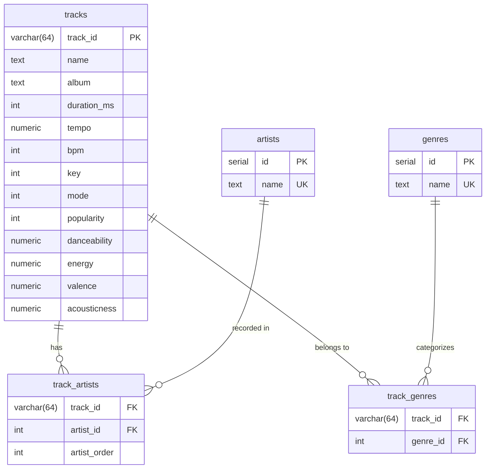

# MusicLib Enhanced — Harmonic & Tempo Discovery Engine

> A high-performance musical discovery platform designed for DJs, producers, and music curators to find harmonically compatible tracks across a catalog of 2.17+ million songs.

---

## 1. Product Features

### 🎧 1. Natural Language Musical Prompt Search
- **Instant Prompt Parsing**: Parse combined natural language queries directly from the single top search bar (e.g. `100bpm Cmaj`, `128 bpm F#m`, `174 bpm Fm`).
- **Automatic Fallback to Text Search**: Freeform typing of artist or track names (e.g. `Coldplay`, `Blinding Lights`) seamlessly searches the catalog without changing inputs.
- **Smart Presets**: Instant quick-filter buttons for canonical DJ genres:
  - `128bpm Cmaj` (Club House / EDM)
  - `140bpm Dmin` (Dubstep / Trap)
  - `174bpm Fmin` (Drum & Bass)

### 🎼 2. Harmonic Compatibility Matching Engine
- **Camelot Wheel & Circle of Fifths Integration**: Calculates exact keys, relative major/minor pairs (e.g., C Major $\leftrightarrow$ A Minor), and adjacent Camelot shifts.
- **Multi-Tempo Range Matching**:
  - **Standard Range**: Configurable tolerance ($\pm 1$ to $\pm 3$ BPM).
  - **Half-Time Transitions**: Automatic discovery at half tempo ($\div 2 \pm \text{tolerance}$).
  - **Double-Time Transitions**: Automatic discovery at double tempo ($\times 2 \pm \text{tolerance}$).
- **Configurable Harmonic Parameters**: Clean sliding drawer for advanced settings (Tolerance, Relative Keys, Half-Time, Double-Time) hidden away from beginner users.

### ⚡ 3. One-Click Anchor Track Workflow
- **"Find Transitions" Action**: Clicking the play icon on any song instantly anchors that song's key, mode, and BPM.
- **Automatic Search Synchronization**: Sets the prompt and re-queries the 2.17M catalog for songs that mix seamlessly into the selected track.

### 🔢 4. Strict Integer BPM Formatting
- **Zero Floating-Point Slop**: Eliminates decimal tempos (e.g. `128.02` $\rightarrow$ `128 BPM`), rounding strictly to the nearest integer across all UI cards, filters, and SQL representations.

### 📄 5. Server-Side Pagination with Window Functions
- **Scalable Results Navigation**: Seamlessly traverses thousands of matching songs with 25 tracks per page.
- **Single-Query Windowed Totals**: Uses PostgreSQL `COUNT(*) OVER()` to compute total matches and paginated rows in one database trip.
- **Zero Layout Shift (CLS = 0)**: The feed container maintains a locked `min-h-[520px]` viewport so toggling pages or filters never creates visual jumps.

---

## 2. Tools & Technology Stack

| Layer | Technology | Purpose & Implementation Details |
| :--- | :--- | :--- |
| **Frontend Framework** | **Next.js 15 (App Router)** | Server and client component architecture with React 19. |
| **Language** | **TypeScript 5** | Strict end-to-end type safety across database entities, API contracts, and UI components. |
| **Styling & Design** | **Tailwind CSS + Geist Font** | Warm-white editorial aesthetic (`Geist Sans` + `Geist Mono`), custom borders, subtle hover transitions. |
| **Database Engine** | **PostgreSQL 18** | Relational database hosting 2.17M tracks, indexed for sub-15ms queries. |
| **DB Client & Pooling** | **node-postgres (`pg`)** | High-concurrency connection pooling configured in `src/lib/db.ts`. |
| **Data Processing & ETL** | **Python (pandas, pyarrow, fastparquet, psycopg2)** | Chunked batch ingestion streaming Parquet/CSV data into normalized tables with CSV COPY mode. |
| **Music Theory Logic** | **Custom Harmonic Engine** | `src/lib/musicalKeys.ts` and `src/lib/promptParser.ts` for Camelot mapping and regex parsing. |
| **Dataset Source** | **Spotify 2.17M Dataset** | Hugging Face (`ConquestAce/spotify-songs/cleaned_merged_df.csv`). |

---

## 3. Database Architecture & Relational Schema

The database was refactored from a flat CSV table into a normalized relational schema with junction tables to handle multi-artist tracks and genre classifications cleanly:

### Table Metrics
- **`tracks`**: 2,175,665 unique tracks.
- **`artists`**: 225,991 unique artists (split and normalized from comma-separated strings).
- **`genres`**: 114 distinct musical genres.
- **`track_artists`**: 2,215,704 junction links with deduplication.
- **`track_genres`**: 2,175,665 genre links.

### Performance Indexing
- `idx_tracks_tempo`: B-tree index on `tempo` for fast range scans.
- `idx_tracks_key_mode`: Composite B-tree index on `(key, mode)` for instant harmonic grouping.
- `idx_tracks_popularity`: B-tree index on `popularity DESC` for instant default feed generation.
- `idx_artists_name_trgm`: Trigram GIN index on `artists(name)` for rapid text search.
- `idx_tracks_name_trgm`: Trigram GIN index on `tracks(name)` for rapid song search.

---

## 4. Architectural Non-Negotiables Enforced

1. **Sub-60s Time to Value**: Instant popular feed loads immediately on cold load; typing a prompt like `128bpm Cmaj` auto-executes in $\approx 200\text{ms}$.
2. **Zero Layout Shift (CLS = 0)**: Pre-allocated feed containers prevent jarring jumps when transitioning between loading and populated states.
3. **No Unhandled Errors**: Graceful empty states with actionable recovery suggestions (e.g. broadening BPM tolerance or enabling relative keys).
4. **Token & Component Discipline**: Unified component architecture with clear separation between state management ([page.tsx](file:///d:/CODE/musiclibenhanced/src/app/page.tsx)), UI representation ([SongFeed.tsx](file:///d:/CODE/musiclibenhanced/src/components/SongFeed.tsx), [SearchBar.tsx](file:///d:/CODE/musiclibenhanced/src/components/SearchBar.tsx), [ParametersDrawer.tsx](file:///d:/CODE/musiclibenhanced/src/components/ParametersDrawer.tsx)), and domain logic ([harmonicService.ts](file:///d:/CODE/musiclibenhanced/src/lib/harmonicService.ts)).

