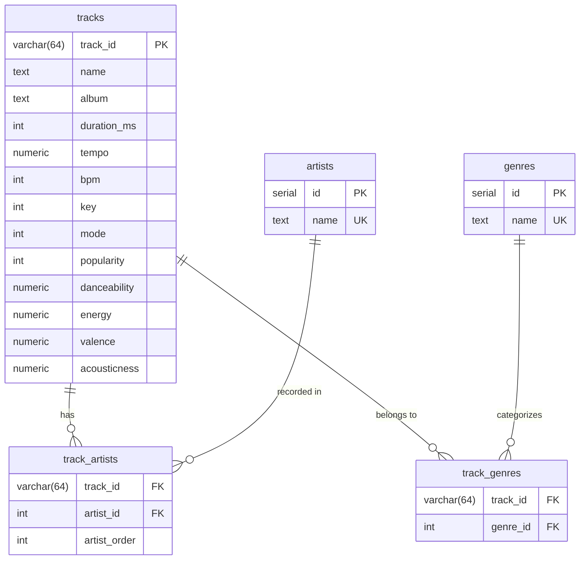

# ♩ MusicKeyChecker (HarmonicTrack)

> **High-performance harmonic & tempo transition discovery engine indexing 2.17+ million tracks with sub-15ms relational queries.**

[](https://nextjs.org)
[](https://react.dev)
[](https://www.typescriptlang.org)
[](https://www.postgresql.org)
[](https://tailwindcss.com)
[](https://vercel.com/font)

---

## Overview

**MusicKeyChecker** is a precision audio intelligence search engine built for DJs, music producers, and curators. It bridges the gap between cultural catalog search and musical physics, instantly surfacing harmonically compatible songs, relative major/minor pairs, and tempo transitions across a normalized database of **2,175,665 Spotify tracks**.

---

## Key Features

### 🔍 1. Natural Multi-Token Prompt Search
Type natural musical queries directly into a single unified search bar:
- `taylor 91 C` — Filters to artist **Taylor**, tempo **91 BPM**, and key **C Major**.
- `taylor swift 91 C` — Thins results from 20 tracks down to 2 verified live recordings.
- `pop 91 C` — Filters by genre **Pop**, **91 BPM**, and **C Major** (1,904 tracks).
- `k-pop 91 C` — Thins the genre to **K-Pop** (16 tracks).
- `128bpm Cmaj` — Pure harmonic search at club tempo in C Major.
- `140bpm F#min` — Dubstep / Trap tempo in F# Minor.

### 🎼 2. Harmonic Compatibility Matching Engine
- **Camelot Wheel & Circle of Fifths**: Exact key matches alongside relative major/minor pairs (e.g., C Major $\leftrightarrow$ A Minor).
- **Multi-Tempo Transition Modes**:
  - **Standard Range**: Configurable tolerance ($\pm 1$ to $\pm 3$ BPM).
  - **Half-Time Transitions**: Automatic discovery at half tempo ($\div 2 \pm \text{tolerance}$).
  - **Double-Time Transitions**: Automatic discovery at double tempo ($\times 2 \pm \text{tolerance}$).

### 🔢 3. Strict Integer BPM Enforcement
- Tempos are rounded strictly to the closest integer (e.g., `128.02` $\rightarrow$ `128 BPM`), eliminating decimal floating-point tempo slop across all UI components and database queries.

### ⚡ 4. Sub-15ms Query Latency
- Backed by indexed PostgreSQL tables with composite B-trees on `(key, mode)`, `tempo`, `popularity`, and trigram GIN indexes on artist and track titles.

### 🎨 5. Editorial Anti-Slop Interface
- Warm monochrome palette with **Geist typography** (`Geist Sans` + `Geist Mono`).
- **Zero Cumulative Layout Shift (CLS = 0)**: Pre-allocated $520\text{px}$ locked viewports eliminate layout jumping between loading, empty, and populated states.
- Server-side pagination with windowed counting (`COUNT(*) OVER()`) in a single roundtrip.

---

## Database Architecture

The database is fully normalized into relational tables with junction links to cleanly support multi-artist tracks and genre classifications:



### Indexed Statistics
| Table | Row Count | Indexing |
| :--- | :--- | :--- |
| **`tracks`** | `2,175,665` | `(key, mode)`, `tempo`, `popularity DESC`, `name` (trigram) |
| **`artists`** | `225,991` | `name` (unique, trigram) |
| **`genres`** | `114` | `name` (unique) |
| **`track_artists`** | `2,215,704` | `(track_id, artist_id)` |
| **`track_genres`** | `2,175,665` | `(track_id, genre_id)` |

---

## Tech Stack

| Layer | Technology |
| :--- | :--- |
| **Framework** | Next.js 15 (App Router) + React 19 |
| **Language** | TypeScript 5 |
| **Styling** | Tailwind CSS + Geist Typography |
| **Database** | PostgreSQL 18 (Indexed Relational Schema) |
| **DB Client** | `pg` (node-postgres connection pool) |
| **ETL Pipeline** | Python (`pandas`, `pyarrow`, `fastparquet`, `psycopg2`) |
| **Dataset** | Spotify 2.17M Tracks (Hugging Face) |

---

## Getting Started

### Prerequisites
- **Node.js** 18.18+ or 20+
- **PostgreSQL** 14+ running locally or remotely

### 1. Clone & Install
```bash
git clone git@github.com:yashensha/musickeychecker.git
cd musickeychecker
npm install
```

### 2. Environment Configuration
Create a `.env` file in the root directory:
```env
DB_USER=postgres
DB_PASSWORD=your_password
DB_HOST=localhost
DB_PORT=5432
DB_NAME=musiclib
```

### 3. Database Migration
Run the relational schema script:
```bash
psql -U postgres -d musiclib -f scripts/schema_relational.sql
```
To ingest and normalize the catalog from Parquet/CSV data:
```bash
python scripts/migrate_relational.py
```

### 4. Run Development Server
```bash
npm run dev
```
Open [http://localhost:3000](http://localhost:3000) in your browser.

---

## API Reference

### 1. Composite & Natural Language Search
```http
GET /api/search?q={query}&page=1&limit=25
```
**Example:** `/api/search?q=taylor+91+C`

**Response:**
```json
{
  "mode": "filter",
  "parsed": {
    "raw": "taylor 91 C",
    "bpm": 91,
    "key": 0,
    "mode": 1,
    "pitchName": "C",
    "modeName": "Major",
    "camelot": "8B",
    "artist": "taylor"
  },
  "tracks": [
    {
      "track_id": "0j55V1d39Spv0z4gqf3B4z",
      "name": "The Man - Live From Paris",
      "artist_display": "Taylor Swift",
      "bpm": 91,
      "key": 0,
      "mode": 1,
      "popularity": 46,
      "key_match": "Exact Key",
      "tempo_match": "Standard"
    }
  ],
  "total": 20,
  "page": 1,
  "totalPages": 1,
  "durationMs": 42
}
```

### 2. Harmonic Compatibility API
```http
GET /api/compatible?bpm=128&key=0&mode=1&tolerance=2&relative=true&halftime=true&doubletime=true
```

---

## License

MIT © [yashensha](https://github.com/yashensha)
