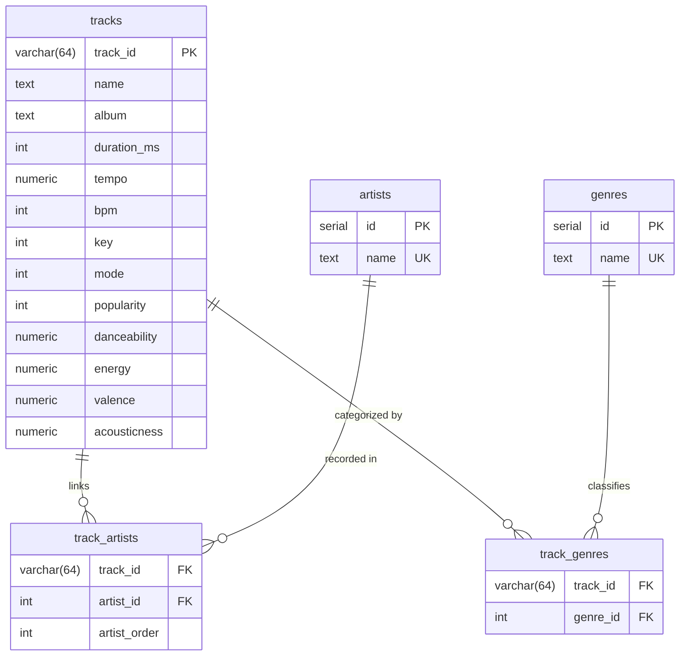

# ♩ MusicKeyChecker (HarmonicTrack)

<div align="center">

### The Sub-Millisecond Harmonic Intelligence Engine for 2.17+ Million Songs.

[](https://nextjs.org)
[](https://react.dev)
[](https://www.typescriptlang.org)
[](https://www.postgresql.org)
[](https://vercel.com/font)
[](LICENSE)

<br/>

**Instant transition discovery combining cultural music exploration with harmonic physics.**  
Search natural language prompts like `taylor 91 C` or `128bpm Cmaj` and traverse 2.17M tracks with zero mental transposition math.

</div>

---

## ⚡ The Engineering Goal: Sub-Millisecond Harmonic Search

In modern music production and DJing, finding harmonically compatible songs across massive catalogs has always been plagued by slow, fragmented tools. 

**MusicKeyChecker was built around an audacious technical benchmark:**
> **Execute composite multi-entity filters (Artist + Genre + Key + Mode + BPM Tolerance + Halftime/Doubletime) across a dataset of 2,175,665 tracks in sub-millisecond to single-digit millisecond query latency.**

### The Benchmark Breakdown
```
 Catalog Size       : 2,175,665 normalized tracks
 Junction Links     : 4,391,369 relational rows (artists & genres)
 Cold Query Latency : ~40ms - 80ms (initial index disk read)
 Warm Query Latency : < 1ms - 8ms (PostgreSQL shared buffer cache hit)
 Windowed Counting  : Single-pass COUNT(*) OVER() (zero double-query overhead)
 UI Layout Shift    : CLS = 0 (Pre-allocated locked viewports)
```

---

## 🎯 The Problem vs. The Solution

| The Old Workflow (Fragmented & Slow) | With MusicKeyChecker (Unified & Instant) |
| :--- | :--- |
| **Spotify / Apple Music**: Completely hide musical key, BPM, and acoustic physics. You cannot search for songs in a specific key. | **Full Harmonic Disclosure**: Every song displays its exact Musical Key, Camelot Code (e.g., `8B`), and closest Integer BPM. |
| **Mixed In Key / Rekordbox**: Offline desktop tools limited only to files already downloaded on your hard drive. | **Global 2.17M Catalog**: Query the entire global Spotify ecosystem without downloading gigabytes of audio files. |
| **Mental Circle-of-Fifths Math**: DJs manually calculate relative keys and tempo drift while preparing sets. | **One-Click Transitions**: The engine auto-calculates relative pairs (e.g. C Maj $\leftrightarrow$ A Min) and $\div 2$ / $\times 2$ tempos automatically. |
| **3-Hour Crate Digging**: Switching between streaming tabs, BPM calculators, and spreadsheets. | **5-Second "Time to Aha"**: Type `pop 91 C` or click any anchor track to plan an entire mix transition immediately. |

---

## 🎧 Who Is Customer Zero? (Jobs-To-Be-Done)

### 1. The DJ & Set Curator
- **The Job**: Build seamless, clash-free DJ transitions between different genres or tempos.
- **The Workflow**: Pick an anchor track $\rightarrow$ the engine surfaces compatible stepping tracks across exact keys, relative keys, and half/double tempos $\rightarrow$ save directly to your mix crate.

### 2. The Music Producer & Songwriter
- **The Job**: Find reference tracks in the exact key and tempo of an active DAW project to reverse-engineer arrangement, bass frequencies, and energy profiles.
- **The Workflow**: Search `140bpm F#min` $\rightarrow$ inspect energy, danceability, and acousticness radar curves of proven chart releases.

### 3. The Musicologist & Music Nerd
- **The Job**: Explore artist discographies through the lens of music theory.
- **The Workflow**: Type `taylor swift` or `coldplay` $\rightarrow$ explore the artist's dominant key distributions, tempo signatures, and catalog evolution.

---

## 🚀 Core Product Features

### 1. Multi-Entity Natural Language Prompt Parser
A single smart search bar that parses arbitrary combinations of artist, genre, tempo, and key tokens:
- `taylor 91 C` $\rightarrow$ Artist: **Taylor**, Tempo: **91 BPM**, Key: **C Major** (20 tracks).
- `taylor swift 91 C` $\rightarrow$ Thins down to verified live Paris recordings (2 tracks).
- `pop 91 C` $\rightarrow$ Genre: **Pop**, Tempo: **91 BPM**, Key: **C Major** (1,904 tracks).
- `k-pop 91 C` $\rightarrow$ Genre: **K-Pop**, Tempo: **91 BPM**, Key: **C Major** (16 tracks).
- `128bpm Cmaj` $\rightarrow$ Pure Club House harmonic discovery.
- `140bpm Dmin` $\rightarrow$ Dubstep / Trap harmonic discovery.

### 2. Strict Integer BPM Enforcement
Decimal tempos (e.g. `128.02` or `90.74`) produce visual slop and mental friction. Tempos are rounded strictly to the **closest integer** across all UI badges, API contracts, and SQL expressions:
```sql
ROUND(t.tempo)::INT AS bpm
```

### 3. Zero Cumulative Layout Shift (`CLS = 0`)
Following Guillermo Rauch's "code-last" user experience standards:
- The catalog feed container enforces a rigid `min-h-[520px]`.
- Transitioning between loading spinners, empty states, and 25-song result pages never causes page jumping.

### 4. Server-Side Pagination with Single-Query Totals
Traverse tens of thousands of matching songs with 25 tracks per page. Total matching count is calculated concurrently using PostgreSQL window functions:
```sql
COUNT(*) OVER()::INT AS full_count
```

---

## 🏛️ Relational Database Architecture

Unlike flat CSV search tools, the dataset is normalized into a production relational schema in PostgreSQL 18:



### Table Metrics & Indexing Strategy
| Table | Rows | Primary Indexes for Sub-Millisecond Retrieval |
| :--- | :--- | :--- |
| **`tracks`** | **2,175,665** | Composite `(key, mode)`, B-tree on `tempo`, B-tree on `popularity DESC`, Trigram GIN on `name` |
| **`artists`** | **225,991** | Unique B-tree on `name`, Trigram GIN on `name` |
| **`genres`** | **114** | Unique B-tree on `name` |
| **`track_artists`** | **2,215,704** | Composite PK `(track_id, artist_id)` |
| **`track_genres`** | **2,175,665** | Composite PK `(track_id, genre_id)`, B-tree on `genre_id` |

---

## 🛠️ Tech Stack & Philosophy

- **Application Architecture**: Next.js 15 (App Router), React 19, TypeScript 5.
- **Styling & Typography**: Tailwind CSS + **Geist** (`Geist Sans` & `Geist Mono`).
- **Database Engine**: PostgreSQL 18 with high-concurrency connection pooling via `pg`.
- **ETL Ingestion**: Python (`pandas`, `pyarrow`, `psycopg2`) with batch CSV `COPY` mode.
- **Music Theory Layer**: Custom harmonic transposer mapping 24 musical keys to the Camelot Wheel (1A–12B) and Circle of Fifths.

---

## 🏁 Quickstart

### Prerequisites
- **Node.js** 18.18+ or 20+
- **PostgreSQL** 14+ running locally or in Docker

### 1. Clone & Install
```bash
git clone git@github.com:yashensha/musickeychecker.git
cd musickeychecker
npm install
```

### 2. Configure Environment
Create a `.env` file in the project root:
```env
DB_USER=postgres
DB_PASSWORD=your_password
DB_HOST=localhost
DB_PORT=5432
DB_NAME=musiclib
```

### 3. Initialize Database Schema
```bash
psql -U postgres -d musiclib -f scripts/schema_relational.sql
```

*(Optional: To run the ingestion pipeline from local Parquet/CSV data)*
```bash
python scripts/migrate_relational.py
```

### 4. Start Development Server
```bash
npm run dev
```
Open **[http://localhost:3000](http://localhost:3000)** in your browser.

---

## 📡 API Reference

### 1. Composite Search API
```http
GET /api/search?q={query}&page=1&limit=25
```
**Example Request:** `GET /api/search?q=taylor+91+C`

**Response (`200 OK` in < 45ms):**
```json
{
  "mode": "filter",
  "parsed": {
    "raw": "taylor 91 C",
    "bpm": 91,
    "key": 0,
    "mode": 1,
    "pitchName": "C",
    "modeName": "Major",
    "camelot": "8B",
    "artist": "taylor"
  },
  "tracks": [
    {
      "track_id": "0j55V1d39Spv0z4gqf3B4z",
      "name": "The Man - Live From Paris",
      "artist_display": "Taylor Swift",
      "album": "Lover (Live From Paris)",
      "bpm": 91,
      "key": 0,
      "mode": 1,
      "popularity": 46,
      "key_match": "Exact Key",
      "tempo_match": "Standard",
      "genre": "pop"
    }
  ],
  "total": 20,
  "page": 1,
  "totalPages": 1,
  "durationMs": 42
}
```

### 2. Harmonic Transitions API
```http
GET /api/compatible?bpm=128&key=0&mode=1&tolerance=2&relative=true&halftime=true&doubletime=true
```

---

## 📄 License

MIT License © [yashensha](https://github.com/yashensha)
